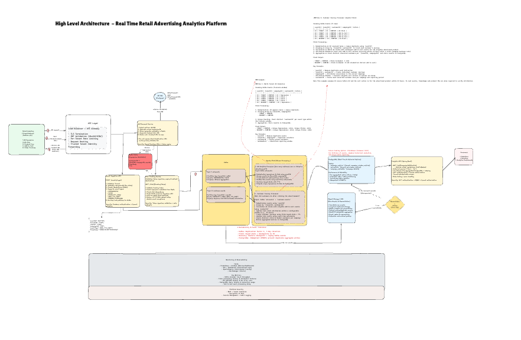
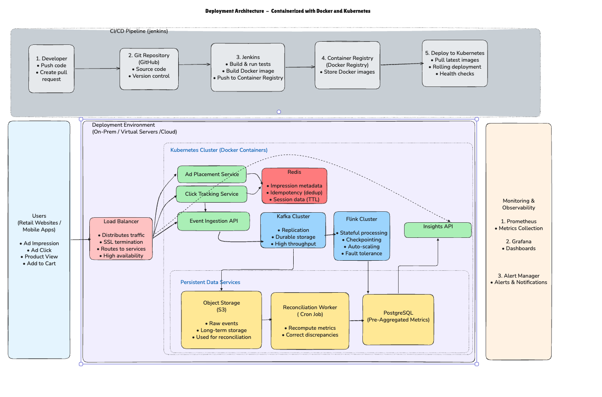

# Retail AdStream — Real-Time Retail Advertising Analytics Platform

## 1. Project Overview

Retail AdStream is a proposed real-time streaming analytics platform for retail advertising networks such as Target Roundel, Walmart Connect, and Amazon Ads.

The platform captures customer interactions, processes advertising events, and provides near-real-time campaign insights to marketers and retailers.

**Key Capabilities**
- Ad impression and click analytics
- Customer session tracking
- Click-to-basket attribution
- Event deduplication and idempotency
- Multi-tenant retailer support
- Historical analytics and reconciliation
- Horizontal scalability and fault tolerance

## 2. High-Level Architecture





**Interactive Architecture Diagram:** [View in Excalidraw](https://excalidraw.com/#json=is2KS1DHUmoRiu9BU8zgO,cRjW5l8Kz5v2Tb7uexFYjA)

### High-Level Architecture — Step-by-Step Flow

1. **Ad Placement:** Selects an ad from PostgreSQL, generates a unique `impressionId`, stores metadata in Redis, and returns a tracked click URL.

2. **Impression Tracking:** When an ad is viewed, an `IMPRESSION` event is sent for processing. Generating an impression ID alone does not count an impression.

3. **Click Tracking:** Validates the tracking token, checks idempotency, records the click durably through Kafka, and redirects the user to the advertiser's page (HTTP 302).

4. **Event Ingestion:** A unified Spring Boot API validates tenant information and processes `IMPRESSION`, `CLICK`, `PRODUCT_VIEW`, and `ADD_TO_CART` events.

5. **Kafka Streaming:** Uses two logical topics:
   - `ad-events` — partitioned by `tenantId + adId` for impression and click analytics.
   - `customer-events` — partitioned by `tenantId + userId` for customer journeys and attribution.

6. **Flink Processing:** Deduplicates events, calculates unique customer counts, tracks sessions, and correlates ad clicks with add-to-cart actions.

7. **Storage & Reconciliation:** PostgreSQL stores pre-aggregated metrics. Object storage retains raw events for historical analysis, replay, and batch reconciliation.

8. **Insights API:** Spring Boot exposes clicks, impressions, and click-to-basket metrics to marketers and retailers through REST APIs.

**Cross-cutting concerns:** Multi-tenancy, horizontal scalability, fault tolerance, monitoring, and data accuracy.

## 3. Technology Choices

| Component | Technology | Purpose |
|---|---|---|
| Backend Services | Java + Spring Boot | REST APIs and business logic |
| Cache | Redis | Impression metadata and idempotency |
| Event Streaming | Apache Kafka | Durable, high-throughput messaging |
| Stream Processing | Apache Flink | Stateful processing and attribution |
| Analytics Database | PostgreSQL | Pre-aggregated campaign metrics |
| Historical Storage | Object Storage | Raw events and reconciliation |
| Containerization | Docker | Application packaging |
| CI/CD | Jenkins | Build, test, and deployment automation |
| Monitoring | Prometheus + Grafana | Metrics, dashboards, and alerts |

**Database Trade-off:** PostgreSQL is suitable for predictable queries over pre-aggregated metrics. For complex analytical queries over billions of raw records, a columnar OLAP database such as ClickHouse could be evaluated.

## 4. Deployment Architecture



### Deployment Architecture — Step-by-Step Flow

1. **Source Control:** Developers push code to GitHub for version control and code reviews.

2. **CI/CD Pipeline:** Jenkins builds the code, executes automated tests, creates Docker images, and pushes them to a container registry.

3. **Independent Service Deployment:** Core Spring Boot services (Ad Placement, Click Tracking, Event Ingestion, and Insights API) are deployed independently, enabling separate releases and scaling.

4. **Load Balancing:** Incoming requests are routed to the appropriate services and distributed across healthy instances.

5. **Horizontal Scaling:** High-traffic services can run multiple instances to handle increased workloads without scaling the entire application.

6. **Event Streaming & Processing:** Kafka provides reliable event streaming, while Flink performs distributed, asynchronous event processing with fault recovery.

7. **Persistent Storage & Reconciliation:** PostgreSQL stores aggregated metrics, while object storage retains raw events. A scheduled reconciliation worker detects and corrects discrepancies.

8. **Monitoring & Alerting:** System health, API latency, errors, event-processing delays, and resource utilization are monitored, with alerts for failures.

### Deployment Strategy

- **Independent Deployments:** Services can be released and scaled separately.
- **Rolling Updates:** Gradually replace running instances to minimize downtime.
- **Health Checks & Rollback:** Detect unhealthy deployments and restore a previous stable version when necessary.
- **Fault Tolerance:** Multiple instances and durable event storage improve availability.

**Trade-off:** Independent deployments improve scalability and fault isolation but increase operational complexity and inter-service communication.

## 5. Insights API — Working Implementation

The Spring Boot implementation is available in the [insights-api](insights-api/) directory.

### API Endpoints

| Method | Endpoint | Description |
|---|---|---|
| GET | `/ad/{campaignId}/clicks` | Unique customers who clicked an ad |
| GET | `/ad/{campaignId}/impressions` | Unique customers who viewed an ad |
| GET | `/ad/{campaignId}/clickToBasket` | Unique customers who added a product to their basket after clicking |

### Technology Stack

- Java 17
- Spring Boot 4.1.2
- Spring Data JPA / Hibernate
- Embedded Database (Local Demo)
- PostgreSQL (Proposed Production Database)
- Maven
- JUnit 5 + Mockito
- Swagger / OpenAPI

### Run Locally

**Prerequisite:** Java 17.

From the repository root:

```bash
cd insights-api
./mvnw spring-boot:run
```

Application URL: `http://localhost:8080`

### Example API Request

```bash
curl -H "X-Tenant-Id: T001" \
  http://localhost:8080/ad/CAMP101/clicks
```

**Example Response**

```json
{
  "tenantId": "T001",
  "campaignId": "CAMP101",
  "clicks": 12000
}
```

### Run Automated Tests

From the `insights-api` directory:

```bash
./mvnw clean test
```

The unit tests cover click counts, impression counts, click-to-basket metrics, zero counts, missing campaigns, and tenant-scoped lookups.

### API Documentation

Swagger UI: `http://localhost:8080/swagger-ui.html`

## 6. Multi-Tenancy

The platform supports multiple retailers using shared infrastructure while maintaining tenant-specific data isolation.

- Each event carries a `tenantId`.
- Kafka and Flink use tenant-aware processing keys.
- PostgreSQL queries are scoped by tenant and campaign.
- Tenant-specific configurations and access controls are part of the proposed production design.

**Security Note:** The local API accepts `X-Tenant-Id` for demonstration purposes. Production tenant identity must be obtained from authenticated credentials rather than trusting a client-provided header.

## 7. Scalability, Reliability & Data Accuracy

### Scalability

- Horizontal scaling of high-traffic services
- Kafka partitioning and consumer parallelism
- Flink distributed processing
- Sharded aggregation for popular advertisements
- Precomputed metrics for low-latency API queries

### Reliability

- Kafka replication and replay
- Flink checkpointing and recovery
- Event idempotency and deduplication
- Health checks and rolling deployments

### Data Accuracy

- Unique-customer counting within defined reporting windows
- Configurable click-to-basket attribution windows
- Raw event archival
- Batch reconciliation and controlled backfills

**Design Consideration:** Summing unique-customer counts across different reporting windows may double-count customers. Arbitrary historical distinct counts require additional processing.

## 8. Monitoring & Observability

The proposed platform monitors:

- Kafka consumer lag
- Flink processing latency and checkpoint failures
- API response times and error rates
- Database query performance
- Service health and resource utilization
- End-to-end event processing delay

Monitoring tools include Prometheus, Grafana, centralized logging, and alerting.

## 9. Implementation Scope & Limitations

This project was prepared as a technical architect system-design and coding exercise.

### Implemented

- Spring Boot Insights API with three endpoints
- Entity, Repository, Service, and Controller layers
- Embedded local database with sample campaign metrics
- Tenant-scoped queries
- Missing-campaign exception handling
- JUnit and Mockito unit tests
- Swagger/OpenAPI configuration

### Proposed Architecture — Not Implemented End-to-End

- Ad Placement and Click Tracking Services
- Event Ingestion Service
- Redis, Kafka, and Flink pipelines
- PostgreSQL production persistence
- Object storage and reconciliation worker
- Containerized production deployment and CI/CD

The current implementation uses sample pre-aggregated metrics rather than live streaming events. Historical date-range filtering, production authentication, and exact distinct-customer calculations across arbitrary windows are future enhancements.

## 10. Future Enhancements

- Real-time Kafka and Flink integration
- Historical analytics and reporting APIs
- Production authentication and tenant authorization
- Automated reconciliation jobs
- Integration and performance testing
- Dedicated OLAP storage for advanced analytics when required
